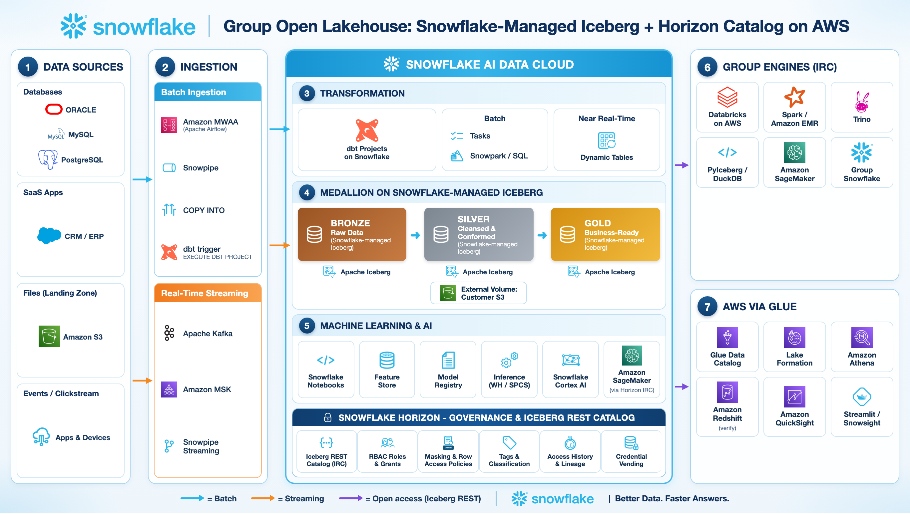

# Hands-on Lab: Interoperable Storage dengan Snowflake-managed Iceberg + Horizon Catalog

> **English:** [README.md](README.md)

Bangun medallion lakehouse (Bronze → Silver → Gold) sebagai **Snowflake-managed Apache Iceberg™ table** yang
disimpan di **bucket Amazon S3 milik Anda sendiri**, terapkan governance sekali saja di **Snowflake Horizon**
(RBAC, masking, row access), lalu biarkan perusahaan lain dalam grup membaca file yang sama dari **Databricks,
Apache Spark, Trino, PyIceberg, dan Amazon Athena** — tanpa copy data dan tanpa layanan catalog tambahan.



Penjelasan diagram langkah demi langkah: [architecture/group_open_lakehouse_horizon_workflow.md](architecture/group_open_lakehouse_horizon_workflow.md)

---

## Apakah masih perlu Snowflake Open Catalog?

**Tidak — untuk Snowflake-managed Iceberg table, Open Catalog sudah tidak diperlukan.** Pola lama adalah
*Snowflake-managed Iceberg → catalog sync ke Snowflake Open Catalog (Polaris) → engine membaca Open Catalog*.
Sekarang setiap akun Snowflake sudah menyediakan endpoint **Horizon Iceberg REST Catalog (IRC)**:

```
https://<org>-<account>.snowflakecomputing.com/polaris/api/catalog
```

Engine berbicara dengan protokol standar Iceberg REST, login sebagai user + role Snowflake, dan menerima kredensial
S3 berumur pendek (credential vending). Governance Snowflake yang ikut terbawa — sudah diverifikasi di lab ini:

| Kontrol governance | Berlaku untuk engine eksternal? |
|---|---|
| RBAC (grant database / schema / table) | **Ya, untuk semua engine.** Schema yang tidak di-grant bahkan tidak muncul di daftar. |
| Role read-only vs write | **Ya.** Role yang hanya punya SELECT mendapat kredensial read-only; commit ditolak. |
| Masking + row access policy | **Ya, untuk engine yang mengimplementasikan Iceberg Scan Plan API** (Spark / Databricks dengan Iceberg 1.11+). Horizon yang merencanakan scan dan hanya mengembalikan baris yang sudah di-mask / difilter. |
| Policy yang sama, engine tanpa Scan Plan (PyIceberg 0.12, Trino, Glue/Athena) | Engine **tidak diberi kredensial** untuk tabel yang diproteksi, sehingga PII mentah tidak pernah keluar. Untuk konsumen ini, publish tabel khusus tanpa policy (Lab 5). |
| Audit | `SNOWFLAKE.ACCOUNT_USAGE.ACCESS_HISTORY` dengan `event_source = 'horizon_irc'`. |

Open Catalog tetap relevan jika Anda butuh **catalog mandiri multi-engine** di mana engine lain memiliki dan menulis
tabelnya sendiri. Untuk pola "Snowflake menulis, grup membaca" — seperti lab ini — Horizon IRC lebih sederhana.

Penegakan policy untuk engine eksternal saat ini berstatus **Preview (Enterprise Edition ke atas)**.
Cek status terbaru di [dokumentasi](https://docs.snowflake.com/en/user-guide/tables-iceberg-query-using-external-query-engine-snowflake-horizon-enforce-access-policies).

---

## Apa yang dibangun

| Objek | Fungsi |
|---|---|
| `LAKEHOUSE_EXT_VOL` | External volume ke bucket S3 Anda (`s3://<bucket>/lakehouse/`) |
| `GROUP_LAKEHOUSE.BRONZE / SILVER / GOLD` | Snowflake-managed Iceberg table (catalog = Snowflake/Horizon) |
| `GROUP_LAKEHOUSE.GOVERNANCE` | Tag, masking policy, row access policy, mapping table |
| `GROUP_SHARE_AWS.SALES` | Dynamic Iceberg Table tanpa PII yang di-publish untuk perusahaan pengguna Athena |
| Role | `LAKEHOUSE_ADMIN`, `DATA_ENGINEER`, `GROUP_DBX_READER`, `GROUP_AWS_READER` |
| Service user | `SVC_GROUP_DBX_READER`, `SVC_GROUP_AWS_READER` (autentikasi PAT) |

Model akses yang akan dibuktikan dari luar Snowflake:

| Role | Melihat | PII | Region |
|---|---|---|---|
| `DATA_ENGINEER` | Bronze, Silver, Gold (baca/tulis) | jelas | semua |
| `GROUP_DBX_READER` (Databricks / Spark / Trino) | Silver, Gold | di-mask | semua |
| `GROUP_AWS_READER` (Athena via Glue) | Gold + `GROUP_SHARE_AWS` | di-mask / tidak ada | JAKARTA, JAWA BARAT |

Ingestion dan transformation (Amazon MWAA, dbt Projects on Snowflake) ada di arsitektur namun **di luar cakupan**
lab: data Bronze dibuat secara sintetis dan Silver/Gold dibangun dengan SQL biasa. Tool apa pun yang menulis
tabelnya, interoperabilitas hanya bergantung pada target berupa Snowflake-managed Iceberg table.

## Struktur repository

```
architecture/            reference architecture (PNG + HTML yang bisa diedit + penjelasan workflow)
aws/                     S3 bucket + IAM untuk external volume, role Lake Formation, Lambda refresh token
sql/                     Lab Snowflake 00 - 05 dan 99 (jalankan berurutan)
scripts/                 verify_horizon_irc.sh - uji cepat PAT ke Horizon IRC
clients/spark/           OSS Spark / EMR / Glue job                         (Lab 6b)
clients/pyiceberg/       PyIceberg - laptop, SageMaker, Lambda               (Lab 6a)
clients/trino/           Trino di Docker                                     (Lab 6c)
clients/databricks/      Notebook Databricks + konfigurasi cluster           (Lab 7)
clients/athena/          Query Athena di Glue federated catalog              (Lab 8)
```

## Prasyarat

* Akun Snowflake di **AWS**, Enterprise Edition atau lebih tinggi, dan user dengan `ACCOUNTADMIN` untuk lab setup.
* Akun AWS yang bisa membuat S3 bucket dan IAM role (disarankan region yang sama dengan Snowflake — lintas region
  menambah latency dan biaya egress). AWS CLI v2.
* Untuk lab client: Python 3.10+, Java 11+ (Spark), Docker (Trino), workspace Databricks di AWS, dan hak admin
  Lake Formation (lab Athena).

---

## Lab 0 — Role dan warehouse  · `sql/00_setup_roles_warehouse.sql`

Jalankan sebagai `ACCOUNTADMIN`. Membuat empat role lab, warehouse `LAKEHOUSE_WH`, dan memberi Anda `LAKEHOUSE_ADMIN`.
Catat `account_identifier` yang dikembalikan (`<org>-<account>`) — semua engine membutuhkannya.

## Lab 1 — External volume ke bucket S3 Anda  · `aws/setup_aws.sh` + `sql/01_external_volume.sql`

```bash
export BUCKET=<nama-bucket-unik> AWS_REGION=<region-snowflake, mis. ap-southeast-3>
./aws/setup_aws.sh create        # bucket (versioning, public access diblok) + IAM role + S3 policy
```

Ganti nama bucket dan account id di `sql/01_external_volume.sql`, jalankan, lalu salin `STORAGE_AWS_IAM_USER_ARN`
dan `STORAGE_AWS_EXTERNAL_ID` dari `DESC EXTERNAL VOLUME`:

```bash
./aws/setup_aws.sh trust <STORAGE_AWS_IAM_USER_ARN> <STORAGE_AWS_EXTERNAL_ID>
```

Jalankan ulang `SELECT SYSTEM$VERIFY_EXTERNAL_VOLUME('LAKEHOUSE_EXT_VOL');` sampai hasilnya `"success": true`.

> **Role owner tabel wajib tetap punya `USAGE` pada external volume**, kalau tidak setiap permintaan vended
> credential dari engine eksternal akan gagal. Role yang membaca tabel ber-policy lewat Scan Plan API juga butuh
> `USAGE` (Horizon menulis dataset hasil filter ke sana). Script sudah memberi keduanya.

## Lab 2 — Medallion di Snowflake-managed Iceberg  · `sql/02_medallion_iceberg_tables.sql`

Membuat `GROUP_LAKEHOUSE` dengan `CATALOG = 'SNOWFLAKE'` dan `EXTERNAL_VOLUME = 'LAKEHOUSE_EXT_VOL'` di level
database, sehingga semua tabel mewarisinya. Men-generate 5.000 customer dan 100.000 transaksi di Bronze, lalu
membangun Silver (dedup, standarisasi) dan Gold (`CUSTOMER_360`, `REGIONAL_SALES_DAILY`).

Cek file di S3 — inilah yang dibaca engine lain:

```sql
SHOW ICEBERG TABLES IN DATABASE GROUP_LAKEHOUSE;
SELECT SYSTEM$GET_ICEBERG_TABLE_INFORMATION('GROUP_LAKEHOUSE.GOLD.CUSTOMER_360');
```

```bash
aws s3 ls s3://$BUCKET/lakehouse/gold/ --recursive | head
```

Snowflake yang melakukan commit snapshot serta compaction / snapshot expiry; konsumen tidak perlu memelihara tabel.

## Lab 3 — Governance: RBAC, tag, masking, row access  · `sql/03_governance_rbac_masking.sql`

* **RBAC** — `GROUP_DBX_READER` mendapat Silver + Gold, `GROUP_AWS_READER` hanya Gold, Bronze tidak pernah di-grant.
  Grant `FUTURE ICEBERG TABLES` membuat tabel baru otomatis ikut ter-share.
* **Tag** `PII_TYPE` pada email / phone / NIK.
* **Masking** — `MASK_EMAIL` mempertahankan domain (`*****@example.com`), `MASK_PII_STRING` mengembalikan `***MASKED***`.
* **Row access** — `RAP_REGION` dengan mapping table: perusahaan AWS hanya melihat JAKARTA dan JAWA BARAT.

Predicate policy sengaja memakai pola yang didokumentasikan Snowflake sebagai didukung Scan Plan API
(`CURRENT_ROLE() IN (...)`, `EXISTS` ke mapping table). Blok tes di akhir memakai `USE SECONDARY ROLES NONE` —
engine eksternal hanya memakai satu role, jadi uji dengan cara yang sama.

## Lab 4 — Service user dan PAT  · `sql/04_service_users_pat.sql` + `scripts/verify_horizon_irc.sh`

Satu user `TYPE = SERVICE` per perusahaan konsumen, masing-masing dengan satu role read-only dan
**Programmatic Access Token** yang dibatasi ke role tersebut. Segera salin setiap `token_secret` dan simpan di
secret manager.

PAT untuk service user secara default mewajibkan network policy. Lab ini memasang authentication policy yang
melonggarkan aturan tersebut hanya untuk dua user lab; **di production, pasang network policy yang mengizinkan IP
egress engine**, atau gunakan key-pair / External OAuth / Workload Identity Federation.

Uji cepat sebelum menyentuh engine apa pun:

```bash
export SNOWFLAKE_ACCOUNT=<org>-<account> SNOWFLAKE_PAT=<token SVC_GROUP_DBX_READER>
./scripts/verify_horizon_irc.sh GROUP_DBX_READER GROUP_LAKEHOUSE
# 3) Namespaces visible to GROUP_DBX_READER
# {"namespaces":[["GOLD"],["SILVER"]],"next-page-token":null}
```

Setting koneksinya sama untuk semua engine:

| Setting | Nilai |
|---|---|
| Tipe catalog | Iceberg REST |
| URI | `https://<org>-<account>.snowflakecomputing.com/polaris/api/catalog` |
| Warehouse | Nama **database** Snowflake, persis seperti hasil `SHOW DATABASES` (`GROUP_LAKEHOUSE`) — bukan virtual warehouse |
| Credential | PAT |
| Scope | `session:role:<ROLE>` |
| Header | `X-Iceberg-Access-Delegation: vended-credentials` |

## Lab 5 — Publish share database untuk Athena  · `sql/05_aws_share_database.sql`

AWS Glue catalog federation membaca metadata tabel lewat Horizon, tetapi membaca **file data dengan IAM role yang
Anda daftarkan di Lake Formation**. Athena tidak memanggil Scan Plan API, sehingga masking / row access Snowflake
tidak dievaluasi di jalur ini. Pola yang aman adalah *publish, bukan expose*:

* database terpisah `GROUP_SHARE_AWS` (satu Glue federated catalog dipetakan ke tepat satu database Snowflake),
* **Dynamic Iceberg Table** yang dijaga tetap fresh oleh Snowflake dari Gold, tanpa kolom PII dan hanya region yang diizinkan,
* format Iceberg v2 dipatok (`ICEBERG_VERSION_DEFAULT = 2`) agar kompatibel dengan Athena,
* prefix S3 sendiri (`lakehouse/share_aws/`), sehingga role Lake Formation bisa dibatasi ke prefix itu dan tidak
  pernah bisa membaca file `GROUP_LAKEHOUSE`.

## Lab 6 — Engine open source

Jalankan **tanpa kredensial AWS pribadi di shell** (`unset AWS_PROFILE AWS_ACCESS_KEY_ID ...`). Tujuannya membuktikan
bahwa vended credential dari Horizon adalah satu-satunya jalan ke data.

### 6a. PyIceberg  · `clients/pyiceberg`

```bash
cd clients/pyiceberg && pip install -r requirements.txt
export SNOWFLAKE_ACCOUNT=<org>-<account> SNOWFLAKE_PAT=<PAT dbx reader>
python read_horizon_iceberg.py
```

Hasil yang diharapkan: namespace `GOLD`, `SILVER`; baris `SILVER.TRANSACTIONS`; `GOLD.CUSTOMER_360` **diblok**
(tabel ber-policy, tidak ada vended credential). PyIceberg 0.12 belum bisa menyelesaikan scan plan asinkron Horizon,
jadi gunakan untuk tabel tanpa policy — misalnya notebook SageMaker yang membaca fitur dari Silver.

### 6b. Apache Spark (EMR, Glue job, SageMaker Spark)  · `clients/spark`

```bash
pip install "pyspark==3.5.*"
export SNOWFLAKE_ACCOUNT=<org>-<account> SNOWFLAKE_PAT=<PAT dbx reader> AWS_REGION=<region bucket>
python clients/spark/spark_horizon_irc.py
```

Memakai `iceberg-spark-runtime-3.5_2.12:1.11.0`. Hasil yang teramati di lab ini dengan `GROUP_DBX_READER`:

```
+-----------+-----------------+------------+----------+-----------+
|customer_id|email            |phone       |region    |total_spend|
+-----------+-----------------+------------+----------+-----------+
|1          |*****@example.com|***MASKED***|JAWA TIMUR|51724091.00|
|2          |*****@example.com|***MASKED***|JAWA TIMUR|35901098.00|
```

Jalankan lagi dengan `SNOWFLAKE_ROLE=GROUP_AWS_READER` dan PAT milik role tersebut: hanya `GOLD` yang terlihat dan
hanya baris JAKARTA dan JAWA BARAT yang kembali — row access policy ditegakkan oleh Horizon, bukan oleh Spark.

### 6c. Trino  · `clients/trino`

```bash
cd clients/trino
export SNOWFLAKE_ACCOUNT=<org>-<account> SNOWFLAKE_PAT=<PAT dbx reader> AWS_REGION=<region bucket>
docker compose up -d
docker exec -i trino-horizon trino --catalog horizon < queries.sql
```

Trino memakai Iceberg connector dengan `iceberg.catalog.type=rest`, OAuth2 credential = PAT, dan vended credential.
Gunakan untuk tabel tanpa policy; query `gold.customer_360` di akhir memang diharapkan gagal.

## Lab 7 — Databricks on AWS  · `clients/databricks/horizon_irc_databricks_notebook.py`

Databricks berperan sebagai Spark biasa: **classic cluster dengan access mode Dedicated (single user)**, DBR 15.4/16.4
LTS, dengan dua library Maven Iceberg dan Spark config yang tercantum di bagian atas notebook (PAT dibaca dari
Databricks secret scope via `{{secrets/horizon/dbx_reader_pat}}`). Import file lewat **Workspace → Import** lalu
jalankan cell-nya: browse namespace, query Silver, query Gold yang di-mask, dan pastikan `INSERT` ditolak.

Federation Unity Catalog ke Horizon tercatat di dokumentasi Snowflake sebagai "not announced", karena itu lab ini
memakai Iceberg REST catalog di level cluster.

## Lab 8 — Amazon Athena via AWS Glue catalog federation  · `aws/` + `clients/athena/athena_queries.sql`

1. **Bearer token di Secrets Manager.** Tukar PAT `SVC_GROUP_AWS_READER` menjadi token (langkah 1 di
   `scripts/verify_horizon_irc.sh`, scope `session:role:GROUP_AWS_READER`) dan simpan sebagai
   `{"BEARER_TOKEN":"<token>"}` di secret `group-lakehouse/horizon-token`. Token berlaku ~1 jam: deploy
   `aws/refresh_horizon_token_lambda.py` dengan jadwal EventBridge `rate(50 minutes)` (PAT disimpan di
   `group-lakehouse/horizon-pat`).
2. **Role Lake Formation.** Buat role `group-share-aws-lf-role` dengan `aws/lakeformation-role-trust.json` dan inline
   policy `aws/lakeformation-role-policy.json` (baca Secrets Manager + baca S3 hanya di `lakehouse/share_aws/*`).
3. **Federated catalog.** Console Lake Formation → **Catalogs → Create catalog** → data source
   **Snowflake Horizon Catalog**:
   * catalog name `group-share-aws`, catalog name in Snowflake `GROUP_SHARE_AWS` (huruf besar)
   * workspace URL `https://<org>-<account>.snowflakecomputing.com`, casing **Uppercase only**
   * authentication **Custom**, secret `group-lakehouse/horizon-token`
   * IAM role `group-share-aws-lf-role` → **Test connection** → **Create catalog**
4. **Grant** principal Athena DESCRIBE / SELECT pada catalog di Lake Formation (gunakan Lake Formation untuk aturan
   kolom/baris tambahan di sisi AWS).
5. **Query** dengan `clients/athena/athena_queries.sql`. Tabel baru di `GROUP_SHARE_AWS.SALES` otomatis muncul.

Langkah console mengikuti artikel AWS Big Data Blog di bagian referensi; pastikan federation ke Snowflake Horizon
tersedia di region AWS Anda.

## Lab 9 — Audit dan clean up  · `sql/99_audit_and_cleanup.sql`

Setiap pemanggilan catalog (`loadTable`, `PlanTableScan`, ...) dari semua engine tercatat di `ACCESS_HISTORY` dengan
`event_source = 'horizon_irc'`, termasuk policy yang dievaluasi (latensi hingga ~3 jam). Blok cleanup yang di-comment
menghapus semua objek lab; menghapus Snowflake-managed Iceberg table juga menghapus file-nya dari S3 setelah
retention period. Hapus resource AWS (catalog, role, secret, Lambda, bucket) secara terpisah.

---

## Catatan kompatibilitas (apa yang sudah diuji)

| Engine / jalur | RBAC | Masking + row access | Status di repo ini |
|---|---|---|---|
| Apache Spark 3.5 + Iceberg 1.11 | ✓ | ✓ ditegakkan Horizon (Scan Plan API) | Dijalankan live |
| PyIceberg 0.12 | ✓ | tabel ber-policy diblok (belum ada async scan plan) | Dijalankan live |
| Horizon IRC REST (curl) | ✓ | n/a | Dijalankan live |
| Dynamic Iceberg Table untuk share DB | ✓ | n/a (tanpa PII by design) | Dijalankan live, dibaca via Horizon IRC |
| Databricks classic cluster | config sama dengan Spark | diharapkan sama dengan Spark 1.11 | Konfigurasi disediakan, belum dijalankan di repo ini |
| Trino | ✓ | tabel ber-policy diblok | Konfigurasi disediakan, belum dijalankan di repo ini |
| Glue federation → Athena | RBAC Snowflake + Lake Formation | **bukan** policy Snowflake — pakai share DB | Langkah disediakan, belum dijalankan di repo ini |

## Pelajaran penting

1. **IAM storage adalah bagian dari governance.** Jika identitas IAM milik engine bisa membaca bucket, engine bisa
   melewati Horizon dengan membaca file Parquet langsung. Saat pengujian, PyIceberg jatuh ke AWS profile lokal dan
   membaca kolom ber-masking dalam bentuk asli. Jangan beri konsumen akses langsung ke bucket; andalkan vended credential.
2. **Satu role per session.** Horizon hanya memakai role di `session:role:<ROLE>` — uji di Snowflake dengan
   `USE SECONDARY ROLES NONE`.
3. **`warehouse` = nama database**, huruf besar, persis seperti `SHOW DATABASES`; jika berbeda hasilnya 404.
4. **Versi Iceberg.** Athena membutuhkan format v2; patok di database yang di-federate.
5. **Pisahkan lokasi.** Jangan menaruh lokasi satu tabel di bawah lokasi tabel lain, dan simpan share database di
   prefix sendiri agar policy S3 bisa dibatasi.
6. **Biaya.** Engine eksternal membayar compute masing-masing. Evaluasi policy Scan Plan ditagih sebagai serverless
   "External Governance" di Snowflake, dan akses lintas region menambah biaya egress.

## Referensi

* [Access Iceberg tables with an external engine through Snowflake Horizon Catalog](https://docs.snowflake.com/en/user-guide/tables-iceberg-query-using-external-query-engine-snowflake-horizon)
* [Enforce data protection policies from external query engines](https://docs.snowflake.com/en/user-guide/tables-iceberg-query-using-external-query-engine-snowflake-horizon-enforce-access-policies)
* [Enforce policies using the Scan Plan API](https://docs.snowflake.com/en/user-guide/tables-iceberg-enforce-access-policies-scan-plan-api)
* [Snowflake-managed Iceberg tables](https://docs.snowflake.com/en/user-guide/tables-iceberg)
* [Configure an external volume for Amazon S3](https://docs.snowflake.com/en/user-guide/tables-iceberg-configure-external-volume-s3)
* [AWS Big Data Blog — Access Snowflake Horizon Catalog data using catalog federation in the AWS Glue Data Catalog](https://aws.amazon.com/blogs/big-data/access-snowflake-horizon-catalog-data-using-catalog-federation-in-the-aws-glue-data-catalog/)

---

*Implementasi referensi generik. Nama, region, dan data bersifat ilustrasi dan tidak menggambarkan organisasi
tertentu. Fitur preview dapat berubah; validasi dengan dokumentasi terbaru sebelum dipakai di production.*
