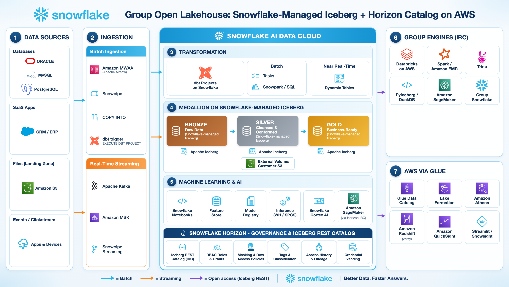

# Hands-on Lab: Interoperable Storage with Snowflake-managed Iceberg + Horizon Catalog

> **Bahasa Indonesia:** [README.id.md](README.id.md)

Build a medallion lakehouse (Bronze → Silver → Gold) as **Snowflake-managed Apache Iceberg™ tables** stored in
**your own Amazon S3 bucket**, govern it once in **Snowflake Horizon** (RBAC, masking, row access), and let
other companies in the group read the same files from **Databricks, Apache Spark, Trino, PyIceberg and
Amazon Athena** — with no copies and no extra catalog service.



Step-by-step explanation of the diagram: [architecture/group_open_lakehouse_horizon_workflow.md](architecture/group_open_lakehouse_horizon_workflow.md)

---

## Do I still need Snowflake Open Catalog?

**No — for Snowflake-managed Iceberg tables you no longer need it.** The earlier pattern was
*Snowflake-managed Iceberg → catalog sync to Snowflake Open Catalog (Polaris) → engines read Open Catalog*.
Today every Snowflake account exposes the **Horizon Iceberg REST Catalog (IRC)** endpoint:

```
https://<org>-<account>.snowflakecomputing.com/polaris/api/catalog
```

Engines speak the standard Iceberg REST protocol to it, authenticate as a Snowflake user + role, and receive
short-lived S3 credentials (credential vending). What carries over from Snowflake governance — verified in this lab:

| Governance control | Applied to external engines? |
|---|---|
| RBAC (database / schema / table grants) | **Yes, every engine.** Ungranted schemas are not even listed. |
| Read-only vs write roles | **Yes.** Horizon vends read-only credentials to a SELECT-only role; commits are rejected. |
| Masking + row access policies | **Yes for engines that implement the Iceberg Scan Plan API** (Spark / Databricks with Iceberg 1.11+). Horizon plans the scan and returns only the masked / filtered rows. |
| Same policies, engine without Scan Plan (PyIceberg 0.12, Trino, Glue/Athena) | The engine gets **no credentials** for the protected table, so raw PII is never handed out. Publish a purpose-built, policy-free table for those consumers (Lab 5). |
| Audit | `SNOWFLAKE.ACCOUNT_USAGE.ACCESS_HISTORY` with `event_source = 'horizon_irc'`. |

Open Catalog is still the right tool if you need a **standalone, multi-engine catalog** in which other engines
own and write their own tables. For "Snowflake writes, the group reads" — this lab — Horizon IRC is simpler.

Policy enforcement for external engines is a **Preview feature (Enterprise Edition or higher)** at the time of writing.
Check the current status in the [documentation](https://docs.snowflake.com/en/user-guide/tables-iceberg-query-using-external-query-engine-snowflake-horizon-enforce-access-policies).

---

## What you build

| Object | Purpose |
|---|---|
| `LAKEHOUSE_EXT_VOL` | External volume on your S3 bucket (`s3://<bucket>/lakehouse/`) |
| `GROUP_LAKEHOUSE.BRONZE / SILVER / GOLD` | Snowflake-managed Iceberg tables (catalog = Snowflake/Horizon) |
| `GROUP_LAKEHOUSE.GOVERNANCE` | Tag, masking policies, row access policy, mapping table |
| `GROUP_SHARE_AWS.SALES` | PII-free Dynamic Iceberg Tables published to the Athena company |
| Roles | `LAKEHOUSE_ADMIN`, `DATA_ENGINEER`, `GROUP_DBX_READER`, `GROUP_AWS_READER` |
| Service users | `SVC_GROUP_DBX_READER`, `SVC_GROUP_AWS_READER` (PAT authentication) |

Access model you will prove from outside Snowflake:

| Role | Sees | PII | Regions |
|---|---|---|---|
| `DATA_ENGINEER` | Bronze, Silver, Gold (read/write) | clear | all |
| `GROUP_DBX_READER` (Databricks / Spark / Trino) | Silver, Gold | masked | all |
| `GROUP_AWS_READER` (Athena via Glue) | Gold + `GROUP_SHARE_AWS` | masked / not present | JAKARTA, JAWA BARAT |

Ingestion and transformation (Amazon MWAA, dbt Projects on Snowflake) are part of the architecture but **out of
scope** for the lab: the Bronze data is generated synthetically and Silver/Gold are built with plain SQL. Whatever
tool writes the tables, interoperability only depends on the target being a Snowflake-managed Iceberg table.

## Repository layout

```
architecture/            reference architecture (PNG + editable HTML + workflow explanation)
aws/                     S3 bucket + IAM for the external volume, Lake Formation role, token-refresh Lambda
sql/                     Snowflake labs 00 - 05 and 99 (run in order)
scripts/                 verify_horizon_irc.sh - smoke-test a PAT against Horizon IRC
clients/spark/           OSS Spark / EMR / Glue job                         (Lab 6b)
clients/pyiceberg/       PyIceberg - laptop, SageMaker, Lambda               (Lab 6a)
clients/trino/           Trino in Docker                                     (Lab 6c)
clients/databricks/      Databricks notebook + cluster configuration         (Lab 7)
clients/athena/          Athena queries on the Glue federated catalog        (Lab 8)
```

## Prerequisites

* Snowflake account on **AWS**, Enterprise Edition or higher, and a user with `ACCOUNTADMIN` for the setup labs.
* An AWS account where you can create an S3 bucket and IAM roles (same region as Snowflake is recommended —
  cross-region adds latency and egress cost). AWS CLI v2.
* For the client labs: Python 3.10+, Java 11+ (Spark), Docker (Trino), a Databricks workspace on AWS, and
  Lake Formation admin rights (Athena lab).

---

## Lab 0 — Roles and warehouse  · `sql/00_setup_roles_warehouse.sql`

Run as `ACCOUNTADMIN`. Creates the four lab roles, the `LAKEHOUSE_WH` warehouse and grants you `LAKEHOUSE_ADMIN`.
Note the `account_identifier` it returns (`<org>-<account>`) — every engine needs it.

## Lab 1 — External volume on your S3 bucket  · `aws/setup_aws.sh` + `sql/01_external_volume.sql`

```bash
export BUCKET=<globally-unique-bucket> AWS_REGION=<snowflake-region, e.g. ap-southeast-3>
./aws/setup_aws.sh create        # bucket (versioned, public access blocked) + IAM role + S3 policy
```

Edit the bucket and account id in `sql/01_external_volume.sql`, run it, then copy `STORAGE_AWS_IAM_USER_ARN` and
`STORAGE_AWS_EXTERNAL_ID` from `DESC EXTERNAL VOLUME`:

```bash
./aws/setup_aws.sh trust <STORAGE_AWS_IAM_USER_ARN> <STORAGE_AWS_EXTERNAL_ID>
```

Re-run `SELECT SYSTEM$VERIFY_EXTERNAL_VOLUME('LAKEHOUSE_EXT_VOL');` until it returns `"success": true`.

> The **table owner role must keep `USAGE` on the external volume**, otherwise every vended-credential request
> from an external engine fails. Roles that read policy-protected tables through the Scan Plan API also need
> `USAGE` on it (Horizon writes the filtered dataset there). The script grants both.

## Lab 2 — Medallion on Snowflake-managed Iceberg  · `sql/02_medallion_iceberg_tables.sql`

Creates `GROUP_LAKEHOUSE` with `CATALOG = 'SNOWFLAKE'` and `EXTERNAL_VOLUME = 'LAKEHOUSE_EXT_VOL'` at database
level, so every table inherits them. Generates 5,000 customers and 100,000 transactions in Bronze, then builds
Silver (dedupe, standardise) and Gold (`CUSTOMER_360`, `REGIONAL_SALES_DAILY`).

Check the files in S3 — these are what other engines read:

```sql
SHOW ICEBERG TABLES IN DATABASE GROUP_LAKEHOUSE;
SELECT SYSTEM$GET_ICEBERG_TABLE_INFORMATION('GROUP_LAKEHOUSE.GOLD.CUSTOMER_360');
```

```bash
aws s3 ls s3://$BUCKET/lakehouse/gold/ --recursive | head
```

Snowflake commits the snapshots and runs compaction / snapshot expiry; consumers never have to maintain the tables.

## Lab 3 — Governance: RBAC, tags, masking, row access  · `sql/03_governance_rbac_masking.sql`

* **RBAC** — `GROUP_DBX_READER` gets Silver + Gold, `GROUP_AWS_READER` gets Gold only, Bronze is never granted.
  `FUTURE ICEBERG TABLES` grants keep new tables shared automatically.
* **Tag** `PII_TYPE` on email / phone / national id.
* **Masking** — `MASK_EMAIL` keeps the domain (`*****@example.com`), `MASK_PII_STRING` returns `***MASKED***`.
* **Row access** — `RAP_REGION` with a mapping table: the AWS company only sees JAKARTA and JAWA BARAT.

Policies are written with predicates that Snowflake documents as supported by the Scan Plan API
(`CURRENT_ROLE() IN (...)`, `EXISTS` on a mapping table). The test block at the end runs with
`USE SECONDARY ROLES NONE` — external engines use exactly one role, so test the same way.

## Lab 4 — Service users and PATs  · `sql/04_service_users_pat.sql` + `scripts/verify_horizon_irc.sh`

One `TYPE = SERVICE` user per consuming company, each with one read-only role and a **Programmatic Access Token**
restricted to that role. Copy each `token_secret` immediately and store it in a secret manager.

PATs for service users require a network policy by default. The lab attaches an authentication policy that relaxes
this for the two lab users only; **in production attach a network policy that allows the engines' egress IPs**, or
use key-pair / External OAuth / Workload Identity Federation.

Smoke-test before touching any engine:

```bash
export SNOWFLAKE_ACCOUNT=<org>-<account> SNOWFLAKE_PAT=<token of SVC_GROUP_DBX_READER>
./scripts/verify_horizon_irc.sh GROUP_DBX_READER GROUP_LAKEHOUSE
# 3) Namespaces visible to GROUP_DBX_READER
# {"namespaces":[["GOLD"],["SILVER"]],"next-page-token":null}
```

The connection settings are the same for every engine:

| Setting | Value |
|---|---|
| Catalog type | Iceberg REST |
| URI | `https://<org>-<account>.snowflakecomputing.com/polaris/api/catalog` |
| Warehouse | Snowflake **database** name, exactly as `SHOW DATABASES` prints it (`GROUP_LAKEHOUSE`) — not a virtual warehouse |
| Credential | the PAT |
| Scope | `session:role:<ROLE>` |
| Header | `X-Iceberg-Access-Delegation: vended-credentials` |

## Lab 5 — Publish a share database for Athena  · `sql/05_aws_share_database.sql`

AWS Glue catalog federation reads table metadata through Horizon but reads **data files with the IAM role you
register in Lake Formation**. Athena does not call the Scan Plan API, so Snowflake masking / row access is not
evaluated on that path. The safe pattern is *publish, don't expose*:

* a separate database `GROUP_SHARE_AWS` (a Glue federated catalog maps to exactly one Snowflake database),
* **Dynamic Iceberg Tables** that Snowflake keeps fresh from Gold, with no PII columns and only the allowed regions,
* Iceberg format v2 pinned (`ICEBERG_VERSION_DEFAULT = 2`) for Athena compatibility,
* its own S3 prefix (`lakehouse/share_aws/`), so the Lake Formation role can be scoped to it and can never read
  `GROUP_LAKEHOUSE` files.

## Lab 6 — Open-source engines

Run these **without personal AWS credentials in your shell** (`unset AWS_PROFILE AWS_ACCESS_KEY_ID ...`). The point
is to prove that Horizon's vended credentials are the only path to the data.

### 6a. PyIceberg  · `clients/pyiceberg`

```bash
cd clients/pyiceberg && pip install -r requirements.txt
export SNOWFLAKE_ACCOUNT=<org>-<account> SNOWFLAKE_PAT=<dbx reader PAT>
python read_horizon_iceberg.py
```

Expected: namespaces `GOLD`, `SILVER`; `SILVER.TRANSACTIONS` rows; `GOLD.CUSTOMER_360` **blocked** (protected table,
no vended credentials). PyIceberg 0.12 cannot yet complete Horizon's asynchronous scan plan, so it is the right tool
for unprotected tables — e.g. a SageMaker notebook reading Silver features.

### 6b. Apache Spark (EMR, Glue jobs, SageMaker Spark)  · `clients/spark`

```bash
pip install "pyspark==3.5.*"
export SNOWFLAKE_ACCOUNT=<org>-<account> SNOWFLAKE_PAT=<dbx reader PAT> AWS_REGION=<bucket region>
python clients/spark/spark_horizon_irc.py
```

Uses `iceberg-spark-runtime-3.5_2.12:1.11.0`. Result observed in this lab with `GROUP_DBX_READER`:

```
+-----------+-----------------+------------+----------+-----------+
|customer_id|email            |phone       |region    |total_spend|
+-----------+-----------------+------------+----------+-----------+
|1          |*****@example.com|***MASKED***|JAWA TIMUR|51724091.00|
|2          |*****@example.com|***MASKED***|JAWA TIMUR|35901098.00|
```

Run it again with `SNOWFLAKE_ROLE=GROUP_AWS_READER` and that role's PAT: only `GOLD` is listed and only JAKARTA and
JAWA BARAT rows come back — the row access policy is enforced by Horizon, not by Spark.

### 6c. Trino  · `clients/trino`

```bash
cd clients/trino
export SNOWFLAKE_ACCOUNT=<org>-<account> SNOWFLAKE_PAT=<dbx reader PAT> AWS_REGION=<bucket region>
docker compose up -d
docker exec -i trino-horizon trino --catalog horizon < queries.sql
```

Trino uses its Iceberg connector with `iceberg.catalog.type=rest`, OAuth2 credential = PAT and vended credentials.
Use it for unprotected tables; the protected `gold.customer_360` query at the end is expected to fail.

## Lab 7 — Databricks on AWS  · `clients/databricks/horizon_irc_databricks_notebook.py`

Databricks acts as plain Spark: a **classic cluster in Dedicated (single user) access mode**, DBR 15.4/16.4 LTS,
with the two Iceberg Maven libraries and the Spark config listed at the top of the notebook (the PAT is read from a
Databricks secret scope with `{{secrets/horizon/dbx_reader_pat}}`). Import the file via **Workspace → Import** and
run the cells: browse namespaces, query Silver, query masked Gold, and confirm that an `INSERT` is rejected.

Unity Catalog federation to Horizon is listed by Snowflake as "not announced", which is why the lab uses the
cluster-level Iceberg REST catalog.

## Lab 8 — Amazon Athena via AWS Glue catalog federation  · `aws/` + `clients/athena/athena_queries.sql`

1. **Bearer token in Secrets Manager.** Exchange the `SVC_GROUP_AWS_READER` PAT for a token (step 1 of
   `scripts/verify_horizon_irc.sh`, scope `session:role:GROUP_AWS_READER`) and store it as
   `{"BEARER_TOKEN":"<token>"}` in secret `group-lakehouse/horizon-token`. The token lives ~1 hour: deploy
   `aws/refresh_horizon_token_lambda.py` on an EventBridge `rate(50 minutes)` schedule (PAT kept in
   `group-lakehouse/horizon-pat`).
2. **Lake Formation role.** Create role `group-share-aws-lf-role` with `aws/lakeformation-role-trust.json` and the
   inline policy `aws/lakeformation-role-policy.json` (Secrets Manager read + S3 read on `lakehouse/share_aws/*` only).
3. **Federated catalog.** Lake Formation console → **Catalogs → Create catalog** → data source
   **Snowflake Horizon Catalog**:
   * catalog name `group-share-aws`, catalog name in Snowflake `GROUP_SHARE_AWS` (upper case)
   * workspace URL `https://<org>-<account>.snowflakecomputing.com`, casing **Uppercase only**
   * authentication **Custom**, secret `group-lakehouse/horizon-token`
   * IAM role `group-share-aws-lf-role` → **Test connection** → **Create catalog**
4. **Grant** the Athena principal DESCRIBE / SELECT on the catalog in Lake Formation (use Lake Formation for any
   further column- or row-level rules on the AWS side).
5. **Query** with `clients/athena/athena_queries.sql`. New tables in `GROUP_SHARE_AWS.SALES` appear automatically.

Console steps follow the AWS Big Data Blog post linked below; check that federation to Snowflake Horizon is
available in your AWS region.

## Lab 9 — Audit and clean up  · `sql/99_audit_and_cleanup.sql`

Every catalog call (`loadTable`, `PlanTableScan`, ...) from every engine is in `ACCESS_HISTORY` with
`event_source = 'horizon_irc'`, including the policies that were evaluated (latency up to ~3 hours). The commented
cleanup block drops all lab objects; dropping Snowflake-managed Iceberg tables also removes their files from S3
after the retention period. Remove the AWS resources (catalog, role, secrets, Lambda, bucket) separately.

---

## Compatibility notes (what was tested)

| Engine / path | RBAC | Masking + row access | Status in this repo |
|---|---|---|---|
| Apache Spark 3.5 + Iceberg 1.11 | ✓ | ✓ enforced by Horizon (Scan Plan API) | Run live |
| PyIceberg 0.12 | ✓ | protected tables blocked (no async scan plan yet) | Run live |
| Horizon IRC REST (curl) | ✓ | n/a | Run live |
| Snowflake Dynamic Iceberg Tables for the share DB | ✓ | n/a (no PII by design) | Run live, read through Horizon IRC |
| Databricks classic cluster | same config as Spark | expected as Spark 1.11 | Configuration provided, not run in this repo |
| Trino | ✓ | protected tables blocked | Configuration provided, not run in this repo |
| Glue federation → Athena | Snowflake RBAC + Lake Formation | **not** Snowflake policies — use the share DB | Steps provided, not run in this repo |

## Lessons learned

1. **Storage IAM is part of governance.** If an engine's own IAM identity can read the bucket, it can bypass
   Horizon by reading Parquet files directly. In testing, PyIceberg fell back to a local AWS profile and read
   masked columns in clear text. Give consumers *no* direct bucket access; rely on vended credentials.
2. **One role per session.** Horizon uses only the role in `session:role:<ROLE>` — test in Snowflake with
   `USE SECONDARY ROLES NONE`.
3. **`warehouse` = database name**, upper case, exactly as `SHOW DATABASES` shows it; a mismatch returns 404.
4. **Iceberg version.** Athena needs format v2; pin it on the database you federate.
5. **Keep locations separate.** Do not nest one table's location under another's, and keep the share database on
   its own prefix so S3 policies can be scoped.
6. **Cost.** External engines pay their own compute. Scan Plan policy evaluation is billed as Snowflake serverless
   "External Governance" compute, and cross-region access adds egress.

## References

* [Access Iceberg tables with an external engine through Snowflake Horizon Catalog](https://docs.snowflake.com/en/user-guide/tables-iceberg-query-using-external-query-engine-snowflake-horizon)
* [Enforce data protection policies from external query engines](https://docs.snowflake.com/en/user-guide/tables-iceberg-query-using-external-query-engine-snowflake-horizon-enforce-access-policies)
* [Enforce policies using the Scan Plan API](https://docs.snowflake.com/en/user-guide/tables-iceberg-enforce-access-policies-scan-plan-api)
* [Snowflake-managed Iceberg tables](https://docs.snowflake.com/en/user-guide/tables-iceberg)
* [Configure an external volume for Amazon S3](https://docs.snowflake.com/en/user-guide/tables-iceberg-configure-external-volume-s3)
* [AWS Big Data Blog — Access Snowflake Horizon Catalog data using catalog federation in the AWS Glue Data Catalog](https://aws.amazon.com/blogs/big-data/access-snowflake-horizon-catalog-data-using-catalog-federation-in-the-aws-glue-data-catalog/)

---

*Generic reference implementation. Names, regions and data are illustrative and do not describe any specific
organisation. Preview features may change; validate against current documentation before production use.*
