# Group Open Lakehouse: Snowflake-Managed Iceberg + Horizon Catalog on AWS — End-to-End Workflow

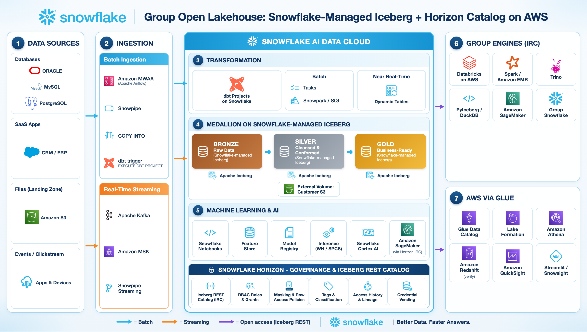

## Overview

This reference architecture shows a conglomerate subsidiary that runs its end-to-end data platform on Snowflake on AWS and publishes its Silver and Gold data to sister companies that use Databricks, Athena/Redshift and other engines. Every medallion layer is a Snowflake-managed Apache Iceberg table: Snowflake (Horizon Catalog) is the catalog and the files sit in the subsidiary's own Amazon S3 bucket. External engines connect directly to the Horizon Iceberg REST Catalog endpoint — Snowflake Open Catalog is no longer required — and Horizon RBAC plus masking / row access policies (through the Scan Plan API) remain the single point of governance. Blue arrows are batch flows, orange arrows are streaming flows and purple arrows are open Iceberg REST access.

## Step-by-step workflow

### 1. Data Sources

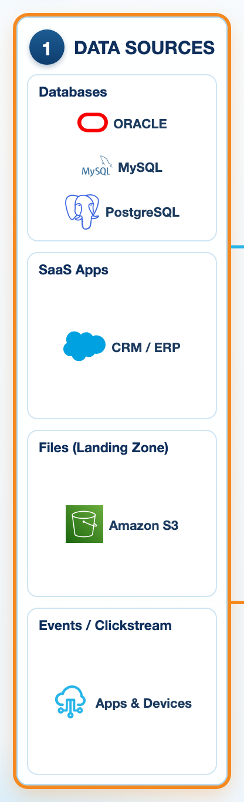

The subsidiary's operational data comes from relational databases, SaaS applications, files landing in its own Amazon S3 buckets and event streams from digital channels. These systems do not change; each is connected through the ingestion pattern that matches its latency and volume.

| Component | Role in the flow |
|---|---|
| **Operational Databases** | Oracle, MySQL, PostgreSQL systems of record (batch or CDC). |
| **SaaS Applications** | CRM / ERP APIs extracted on a schedule. |
| **Files on Amazon S3** | CSV, JSON and Parquet drops in the subsidiary's landing bucket. |
| **Events / Clickstream** | App and device events published to Kafka / Amazon MSK. |

### 2. Ingestion

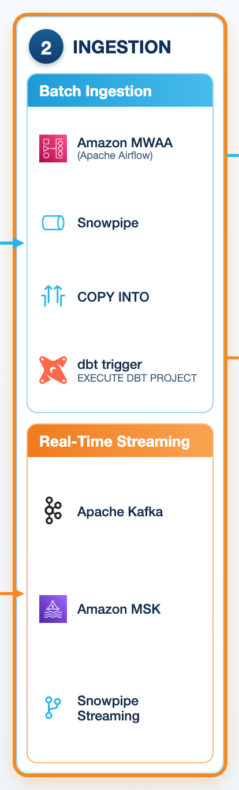

**Amazon MWAA (Apache Airflow)** is the single orchestrator. In the **batch lane** (blue) Airflow DAGs trigger Snowpipe / COPY INTO loads from the S3 landing zone into Bronze, then run `EXECUTE DBT PROJECT` so the dbt models execute natively inside Snowflake. In the **streaming lane** (orange) events from Kafka / Amazon MSK are written with Snowpipe Streaming directly into Bronze Iceberg tables within seconds.

| Component | Role in the flow |
|---|---|
| **Amazon MWAA (Apache Airflow)** | Schedules loads and triggers dbt Projects on Snowflake via the Snowflake provider. |
| **Snowpipe / COPY INTO** | Serverless or scheduled file loading from the S3 landing zone into Bronze. |
| **dbt trigger** | Airflow task runs EXECUTE DBT PROJECT; no dbt runtime to host in MWAA. |
| **Kafka / Amazon MSK** | Event backbone for real-time feeds. |
| **Snowpipe Streaming** | Row-level, low-latency ingestion into Iceberg tables. |

### 3. Transformation

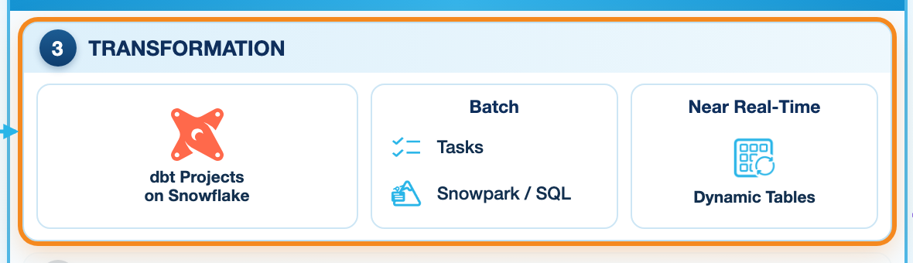

All transformation runs inside Snowflake compute. **dbt Projects on Snowflake** hold the version-controlled Bronze→Silver→Gold models and tests; MWAA only triggers them. Snowflake Tasks and Snowpark cover procedural logic, and **Dynamic Tables** keep near real-time aggregates fresh. Because the target tables are Snowflake-managed Iceberg tables, every write produces open Iceberg data + metadata files in the customer's S3 bucket.

| Component | Role in the flow |
|---|---|
| **dbt Projects on Snowflake** | Modular, tested SQL models deployed as a native DBT PROJECT object. |
| **Tasks / Snowpark / SQL** | Procedural and Python transformations on virtual warehouses. |
| **Dynamic Tables** | Declarative incremental pipelines with a target lag (also as Dynamic Iceberg Tables). |

### 4. Medallion on Snowflake-Managed Iceberg

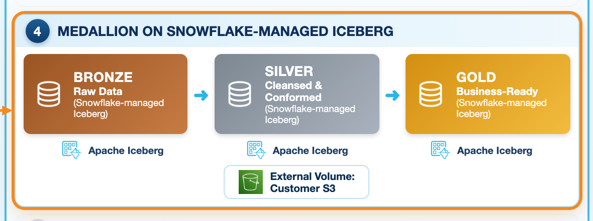

Every layer is a **Snowflake-managed Apache Iceberg table** (`CATALOG = 'SNOWFLAKE'`): Snowflake is the catalog through **Horizon**, and the Parquet data plus Iceberg metadata live in the customer's own **Amazon S3** bucket through an External Volume. Snowflake handles commits, compaction and snapshot expiry. **Bronze** is raw and append-only, **Silver** is cleansed and conformed, **Gold** is business-ready. Silver and Gold are the layers published to the group.

| Component | Role in the flow |
|---|---|
| **Bronze** | Raw, replayable data (Snowflake-managed Iceberg). |
| **Silver** | Cleansed, conformed entities — shared with the group. |
| **Gold** | Business-ready data products — shared with the group. |
| **External Volume: customer S3** | Customer-owned open storage; Snowflake vends scoped credentials to readers. |

### 5. Machine Learning & AI

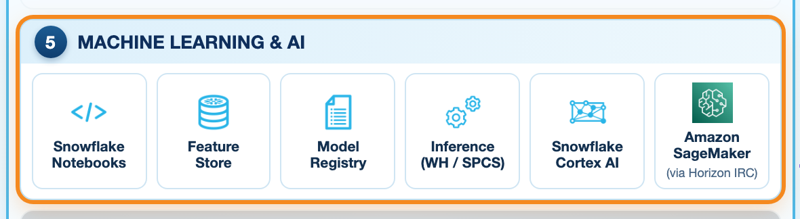

Data scientists train on Silver/Gold in **Snowflake ML** (Notebooks, Feature Store, Model Registry, batch / SPCS inference) and use Cortex AI for LLM use cases. Teams that prefer **Amazon SageMaker** read the same Iceberg tables through the Horizon Iceberg REST endpoint (PyIceberg / Spark) — no copies or exports — and can write scores back to an Iceberg table that Snowflake reads immediately.

| Component | Role in the flow |
|---|---|
| **Snowflake Notebooks** | Python/SQL on warehouse or container runtime. |
| **Feature Store** | Reusable, point-in-time-correct features. |
| **Model Registry** | Versioned, governed models; batch or real-time inference. |
| **Cortex AI** | LLM functions, Cortex Search, Analyst and Agents. |
| **Amazon SageMaker** | Trains on the same Iceberg data via Horizon IRC. |

### Snowflake Horizon - Governance & Iceberg Rest Catalog

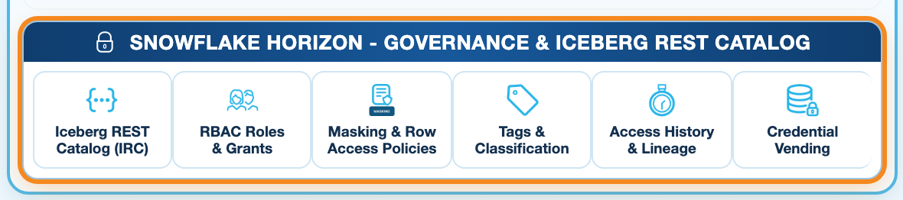

Horizon is both the governance layer and the open catalog. It exposes the **Horizon Iceberg REST Catalog API** (`https://<org>-<account>.snowflakecomputing.com/polaris/api/catalog`), so external engines authenticate with Snowflake users and roles (PAT, key-pair, OAuth or WIF). **RBAC** grants decide which schemas/tables each engine role sees, and **masking and row access policies** are enforced for external engines that implement the **Scan Plan API** (server-side planning — Spark / Databricks with Iceberg 1.11+). For engines that do not, Horizon simply refuses to vend credentials for a protected table, so protected data is never exposed as raw files. Access History records every external read (`event_source = 'horizon_irc'`).

| Component | Role in the flow |
|---|---|
| **Horizon Iceberg REST Catalog** | One open endpoint for Spark, Databricks, Trino, PyIceberg, Glue federation. |
| **RBAC (roles & grants)** | Engine-specific read-only roles; vended S3 credentials scoped per table. |
| **Masking & Row Access Policies** | Enforced in Snowflake and, via the Scan Plan API, in Spark/Databricks (Iceberg 1.11+). |
| **Tags & Classification** | Sensitive-data discovery drives tag-based masking. |
| **Access History & Lineage** | Audit of external engine reads (event_source = horizon_irc). |
| **Credential Vending** | Engines never hold long-lived S3 keys. |

### 6. Group Engines (IRC)

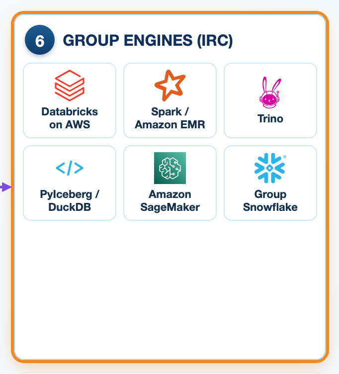

Sister companies connect their own engines **directly to the Horizon Iceberg REST endpoint** — no Snowflake Open Catalog in the middle and no data copies. **Databricks on AWS** (classic cluster with the Apache Iceberg Spark runtime), Apache Spark / Amazon EMR, Trino and PyIceberg / DuckDB each use a read-only Snowflake service user whose role only sees Silver and Gold. Group companies that run Snowflake can also mount the tables through a catalog integration or use Secure Data Sharing.

| Component | Role in the flow |
|---|---|
| **Databricks on AWS** | Spark catalog of type rest pointing at Horizon IRC (dedicated/classic cluster). |
| **Apache Spark / Amazon EMR** | Iceberg Spark runtime 1.11+ for Scan Plan policy enforcement. |
| **Trino** | Iceberg connector with a REST catalog and vended credentials (unprotected tables). |
| **PyIceberg / DuckDB** | Lightweight Python access for notebooks and SageMaker (unprotected tables). |
| **Snowflake (group accounts)** | Catalog integration to Horizon IRC or Secure Data Sharing. |

### 7. AWS via Glue

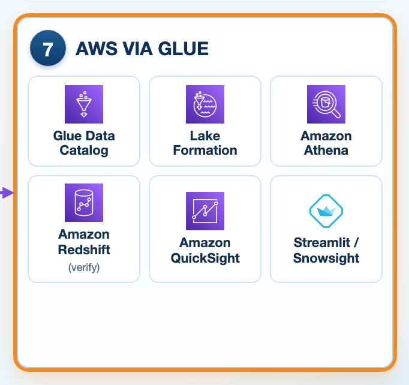

For the AWS-native subsidiary, **AWS Glue Data Catalog catalog federation** mounts one Snowflake database as a federated catalog (authenticated with a Horizon token minted from a Snowflake PAT). Glue reads the metadata through Horizon, but the data files are read with the IAM role registered in **AWS Lake Formation** — Snowflake masking / row access policies are not evaluated on this path. The pattern is therefore *publish, don't expose*: a dedicated database (`GROUP_SHARE_AWS`) of Dynamic Iceberg Tables that already exclude PII and out-of-scope regions, on its own S3 prefix, and a Lake Formation role scoped to that prefix only. **Amazon Athena** then queries it as `"catalog"."schema"."table"`. Amazon Redshift support for the federated catalog should be verified for the customer's region before committing.

| Component | Role in the flow |
|---|---|
| **AWS Glue Data Catalog (federated)** | Mounts the Snowflake database through Horizon IRC. |
| **AWS Lake Formation** | Grants AWS principals DESCRIBE/SELECT on federated objects. |
| **Amazon Athena** | Serverless SQL over the federated Iceberg tables. |
| **Amazon Redshift** | Query via Glue/Lake Formation — verify regional support. |

## End-to-end data paths

### Flow A — Batch medallion pipeline

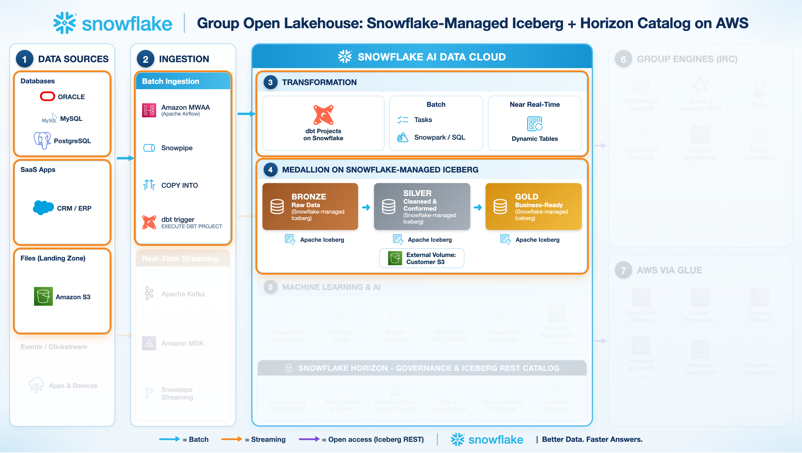

Source data becomes Silver/Gold Iceberg tables in the customer's S3, orchestrated by MWAA and modelled by dbt Projects on Snowflake.

1. Extracts land in the S3 landing zone; an MWAA DAG triggers COPY INTO / Snowpipe into Bronze Iceberg tables.
2. The same DAG runs EXECUTE DBT PROJECT; dbt models cleanse Bronze into Silver and build Gold marts.
3. Snowflake commits each write as Iceberg snapshots (Parquet + metadata) in the customer's S3 bucket and maintains the tables.
4. dbt tests and Data Metric Functions validate quality before the data is published.

### Flow B — Group engines read through Horizon IRC

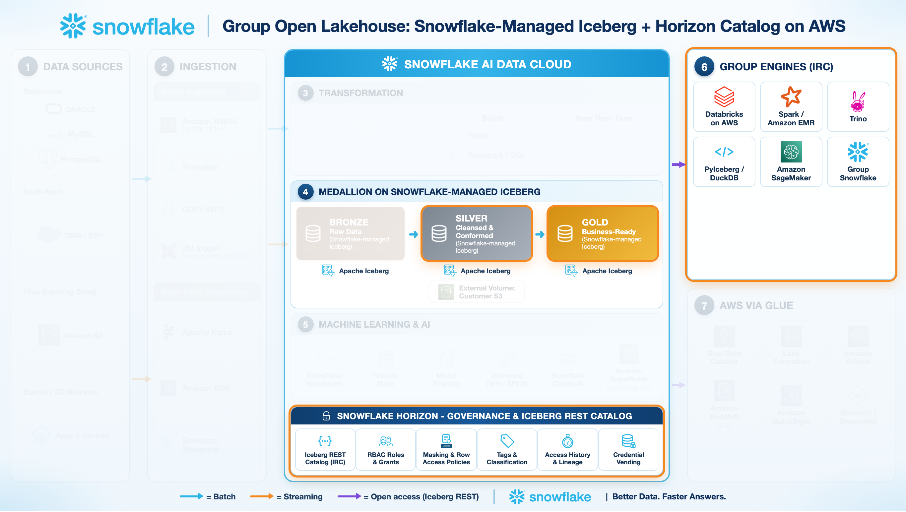

Databricks, Spark, Trino and PyIceberg read the same tables with Snowflake roles and policies applied.

1. A read-only Snowflake service user + role is created per consuming company and granted SELECT on Silver/Gold only.
2. The engine authenticates to https://<org>-<account>.snowflakecomputing.com/polaris/api/catalog with a PAT (or key-pair / OAuth / WIF) and scope session:role:<ROLE>.
3. Horizon checks RBAC and vends short-lived, table-scoped S3 credentials; for protected tables it plans the scan itself (Scan Plan API) and hands out only the masked / filtered result.
4. The engine reads the Parquet files directly from S3; Access History logs the access with event_source = 'horizon_irc'.

### Flow C — AWS analytics via Glue catalog federation

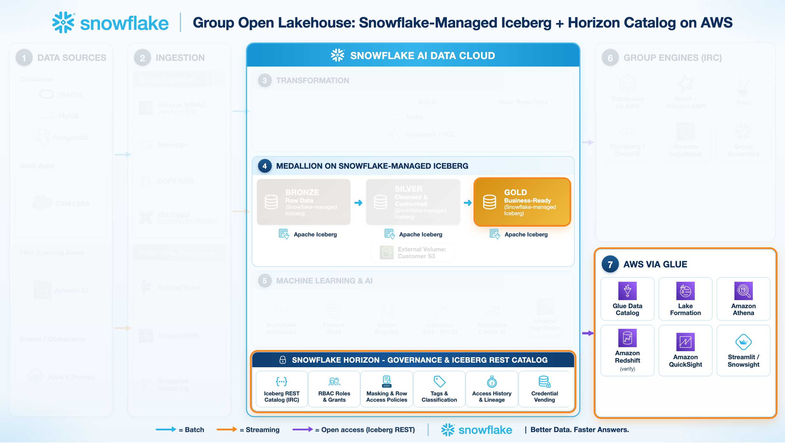

Athena users query a published share database through a Glue federated catalog without any copy or registration job.

1. Snowflake publishes PII-free, region-filtered Dynamic Iceberg Tables in `GROUP_SHARE_AWS` (own S3 prefix); a Horizon bearer token for a read-only role is kept fresh in AWS Secrets Manager.
2. A Lake Formation federated catalog of source *Snowflake Horizon Catalog* is created for that database, registered with an IAM role that can read only the share prefix.
3. Lake Formation grants DESCRIBE/SELECT on the federated databases and tables to AWS principals.
4. Athena (and QuickSight on Athena) query "catalog"."schema"."table"; new Snowflake tables appear automatically.

### Flow D — Machine learning on both platforms

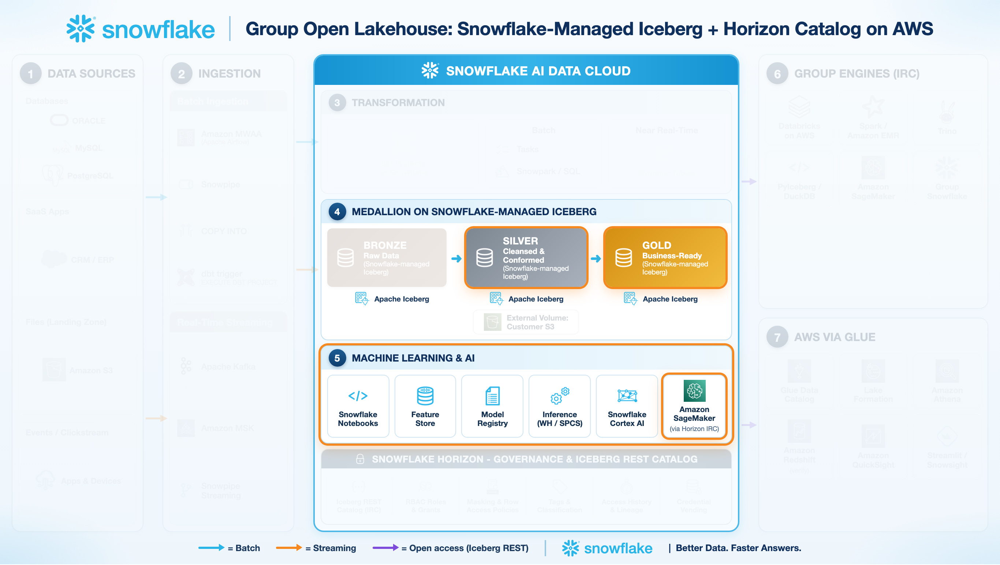

Snowflake ML and Amazon SageMaker train on the same governed Iceberg data.

1. Snowflake ML builds features in the Feature Store and logs models to the Model Registry for batch or SPCS inference.
2. SageMaker notebooks read Silver/Gold with PyIceberg through Horizon IRC using a dedicated ML role.
3. Optional: SageMaker writes predictions to a dedicated Iceberg table through Horizon IRC (write role).
4. Snowflake consumers and BI tools see the predictions immediately; no export pipelines to maintain.

## Benefits

- One copy of data in the customer's own S3, readable by every group engine — no duplication or sync jobs.
- No Snowflake Open Catalog to operate: Horizon exposes the Iceberg REST API in every account.
- Governance defined once in Snowflake (RBAC, masking, row access) and enforced for Spark/Databricks through the Scan Plan API, with a single audit trail; engines without Scan Plan support never receive protected raw files.
- Snowflake manages Iceberg maintenance (compaction, snapshot expiry) while engines keep their own compute and billing.
